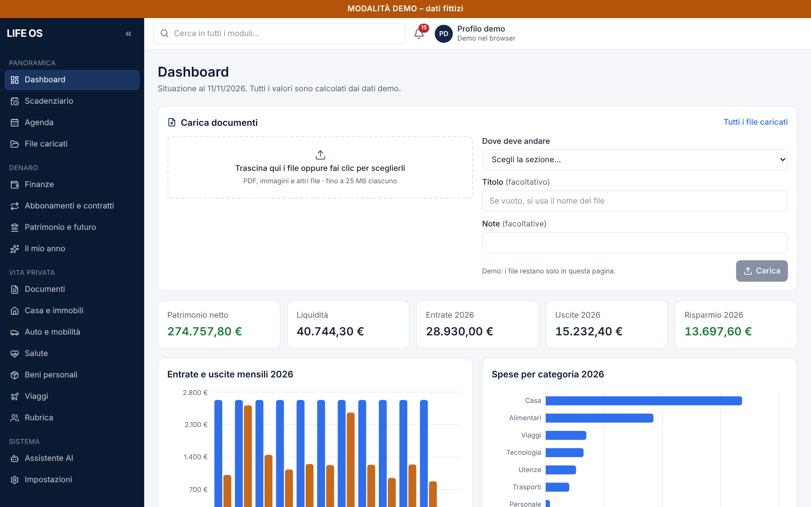
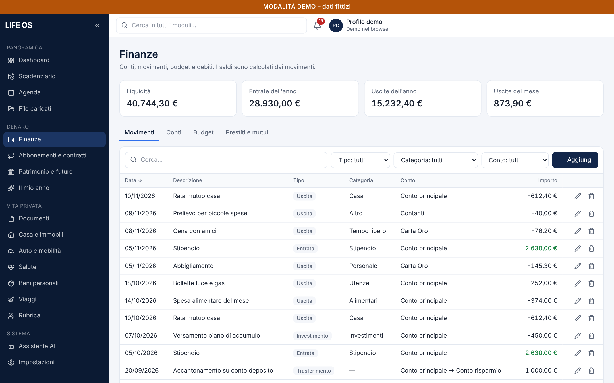
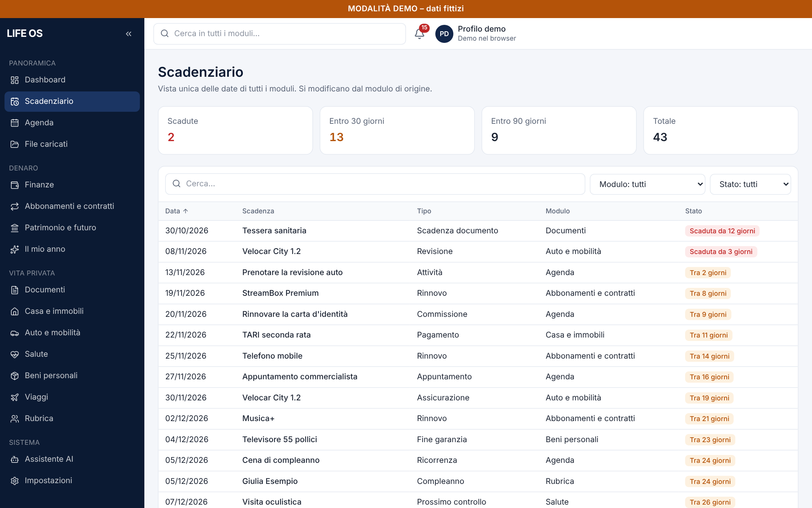
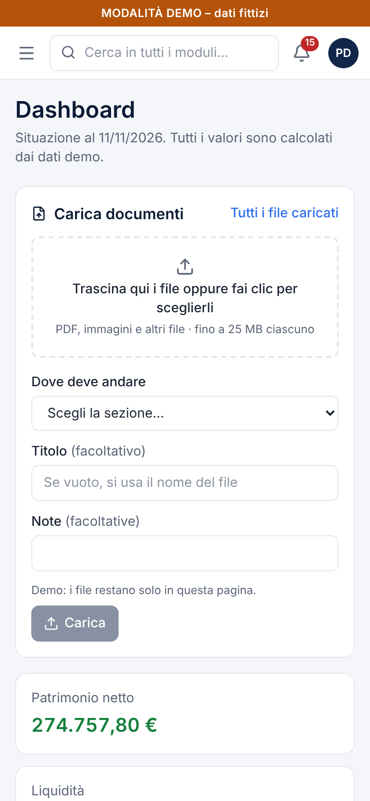

# LIFE OS

Gestionale personale per tenere in un unico posto finanze, documenti, casa, auto, salute, abbonamenti, agenda e scadenze.

**[Prova la demo](https://andreapollastrelli95.github.io/life-os-demo/)** · tutti i dati sono fittizi e restano solo nel tuo browser.



## Cosa fa

- **Dashboard**: patrimonio netto, liquidità, entrate, uscite e risparmio dell'anno, con grafici mensili e per categoria.
- **Finanze**: conti, movimenti, budget e prestiti; i trasferimenti tra conti non falsano entrate e uscite.
- **Scadenziario unico**: raccoglie le scadenze di tutti i moduli (documenti, bollette, revisioni, rinnovi) con avvisi.
- **Documenti e file**: carica PDF e foto e collegali alla sezione giusta; i documenti d'identità hanno la loro scheda con scadenza.
- **Il mio anno**: riepilogo annuale con confronto sull'anno precedente.
- **Ricerca globale**, filtri e ordinamento in ogni tabella, vista ottimizzata per telefono.

| Finanze | Scadenziario | Telefono |
|---|---|---|
|  |  |  |

## Come è fatto

- **Next.js** (App Router) con **TypeScript** e **Tailwind CSS**, esportato come sito statico.
- Moduli, campi e validazioni sono descritti in configurazione (`src/modules`): tabelle, form e filtri vengono generati da lì.
- La logica di calcolo (patrimonio, totali, scadenze, abbonamenti) sta in `src/lib/domain` ed è coperta da test unitari (Vitest).
- Importi gestiti in centesimi interi, date in formato ISO mostrate come GG/MM/AAAA.
- Il livello dati (`src/lib/data`) è l'unico punto che legge e scrive: nella demo usa il browser, nella versione personale un archivio online con accesso protetto da PIN.

## Avviarlo in locale

```bash
npm install
npm run dev      # sviluppo
npm test         # test unitari
npm run build    # sito statico in out/
```

---

Progetto di [Andrea Pollastrelli](https://andreapollastrelli95.github.io/).
